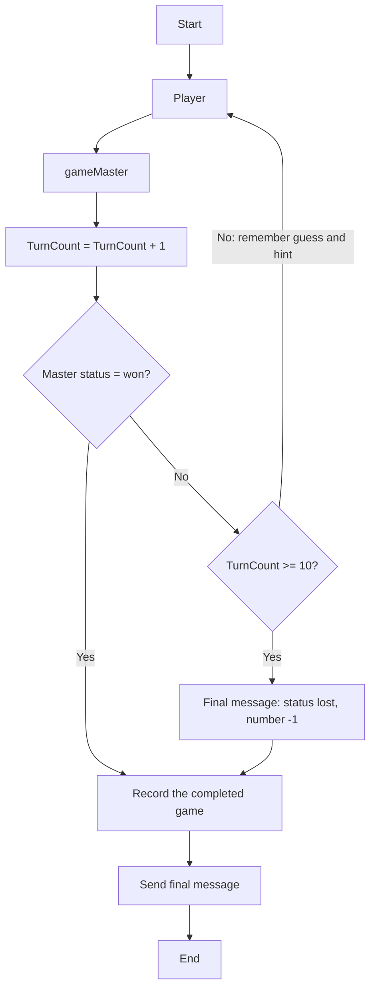

# Demo: Logic Apps Automation

> How can I orchestrate AI roles, control execution, and record the outcome without Foundry Workflow agents?

Use [Azure Logic Apps Automation](https://auto.azure.com/) to run the [stateful workflow definition](../../automation/workflow.json). This is an Automation workflow, not a Foundry Workflow agent or a separately provisioned Consumption logic app.

## Setup

Automation has an independent `AUTOMATION_LOCATION` (default `westus`). The project name includes this region when it differs from `AZURE_LOCATION`, so changing the Automation region does not move Foundry, the tracker, or AI Gateway.

1. Run `azd up`. The post-deploy hook deploys the Foundry `player` and `gameMaster` agents, creates the Automation project and its `guessing-game` application if needed, and publishes the stateful `guessing-game` workflow from `automation\workflow.json` plus its two agent-turn child workflows. Existing projects are preserved because the preview service can fail on repeated project PUTs.
1. The hook creates the Automation-side `foundry-project` agent connection to `PROJECT_ENDPOINT`, authenticated with managed identity. It grants the Automation **application** identity **Foundry User** on `FOUNDRY_PROJECT_RESOURCE_ID` only. The project identity is different and is not used for agent invocation.
1. Open `auto.azure.com` and select the project named by `azd env get-value AUTOMATION_PROJECT_NAME`, the `guessing-game` application, and the **`guessing-game` workflow**. This is the complete game with its top-level loop. `player-turn` and `game-master-turn` are single-turn helpers, not the game orchestrator.
1. The hook configures the following parameters automatically. Do not put credentials in the workflow JSON.

    | Parameter | Value |
    | --- | --- |
    | `modelName` | The Foundry model deployment, normally `gpt-4.1`, also used by the agent actions' designer metadata. The deployed agent definitions select their model. |
    | `playerAgentVersion` | The newly deployed `player` version, saved as `PLAYER_AGENT_VERSION` in azd state. |
    | `gameMasterAgentVersion` | The newly deployed `gameMaster` version, saved as `GAME_MASTER_AGENT_VERSION` in azd state. |
    | `gameTrackerApiUrl` | `azd env get-value GAME_TRACKER_API_URL`, without a trailing slash. This is the Container App backend, not a classic APIM REST proxy. |

    The native `Agent` actions use `FoundryAgentServiceV2` and reference `foundry-project` in the application's `connections.json`. The connection is published before workflow validation. No gateway key or `appsetting()` binding is used by these workflows. Both agent actions hide their inputs and outputs in run history.

1. Resolve any designer diagnostics or missing parameter bindings before testing. Keep the **Request** trigger and **Response** actions. Protect the HTTP trigger with the authentication options available in your application, and treat its signed callback URL as a secret.
1. Deployment invokes the published workflow with `{}` and fails if it does not return a completed, recorded game. For interactive changes, use **Test**, inspect the draft run, then **Publish**. Keep `LOGIC_APPS_WORKFLOW_URL` synchronized if the published trigger URL changes.

The portal designer and **Test** prefer a saved `workflow-draft.json` over the published `workflow.json`, together with the application's `parameters-draft.json` and `connections-draft.json`. An azd publication does not discard an existing portal draft. If the designer shows a different flow while the published run works, compare the draft with the published definition before saving or publishing it; preserve any wanted edits before discarding or restoring the draft. A restored game also needs both agent-version bindings, not only the model and tracker URL. Reload the workflow tab after a server-side draft restoration so the browser does not keep displaying or saving its old copy.

## What to demonstrate

The workflow chooses one integer from 1 through 100. Only the Foundry `gameMaster` agent receives that secret. The Foundry `player` agent gets the rules, its own previous guesses, and validated `higher`/`lower` feedback as a serialized message history. Both use the Automation-side Foundry project connection and their pinned agent versions, not direct HTTP model calls.

The main workflow preserves the original game's control flow, replacing the deprecated `GotoAction` with an actual, top-level **Until** loop:



In the designer, expand **Play up to ten turns**: its normal path is **Player -> Game master -> Count turn -> Check win or turn limit**. A win is checked **first**, so a correct tenth guess wins. Only the non-winning branch checks the ten-turn limit; otherwise it preserves the guess and hint and repeats from Player. The final message is `{"status":"won","number":42}` or the original `{"status":"lost","number":"-1"}`.

The preview runtime supports native `Agent` actions only at a workflow's top level, not inside `Scope` or `Until`. The main loop therefore invokes [player-turn](../../automation/player-turn.json) and [game-master-turn](../../automation/game-master-turn.json) using native `Workflow` actions. Each child has its own top-level Foundry action and validates its response before returning. The master child converts its verified `correct` hint to `status: won`; wrong guesses return `status: playing` and the verified hint. The player child never receives the secret. Deployment validates and publishes the children before the main workflow and waits for each expected definition to become healthy.

Logic Apps owns state and control flow: it validates integer guesses and the master's hint against the actual number, runs at most **10 turns**, and has a **five-minute loop timeout**. Invalid JSON, invalid guesses, incorrect hints, agent errors, and timeouts are execution failures, not game losses. Each agent action allows three internal iterations and fails if its limit is reached; an empty limit-reached output is never accepted as a completed turn.

After a completed game, the workflow records `{conversation_id, number_picked, status}` in the tracker API. The conversation ID is the workflow run ID, and even a lost game records the real number (1-100), not the loss message's `-1` sentinel. HTTP 200 sends the final message only after recording succeeds, then the conversation ends. A failure returns HTTP 502 and leaves the run failed, with diagnostics in **Monitoring**. Model and record requests do not automatically retry, avoiding repeated turns or duplicate writes.

Use **Monitoring** to follow the actions and loop iterations. Secure agent inputs/outputs are intentionally hidden; do not disable that protection in a shared demo.

## Run from the command line

Python 3.10+ is sufficient; the caller has no package dependencies:

```powershell
$env:LOGIC_APPS_WORKFLOW_URL = azd env get-value LOGIC_APPS_WORKFLOW_URL
python .\automation\run_workflow.py
```

The runner invokes Logic Apps, validates the completed result and recording confirmation, and exits nonzero on errors. It does not call Foundry agent APIs or record the session a second time.

Example response (IDs vary):

```json
{
  "conversation_id": "workflow-run-id",
  "number_picked": 42,
  "status": "won",
  "turns": 6,
  "message": {
    "status": "won",
    "number": 42
  },
  "session": {
    "message": "Game session recorded: won (number: 42, conversation: workflow-run-id)",
    "session_id": "recorded-session-id"
  }
}
```

If a caller disconnects or times out, inspect run history before starting another run: the original workflow may still complete and persist a session. The demo tracker does not deduplicate repeated submissions. The REST backend is public and unauthenticated for demonstration; configure backend authentication/network restrictions before production use.

See the official [Automation workflow quickstart](https://learn.microsoft.com/azure/logic-apps/automation/quickstart-create-dynamic-automation-workflows) and [workflow/code-view reference](https://auto.azure.com/docs/features/workflows/).
