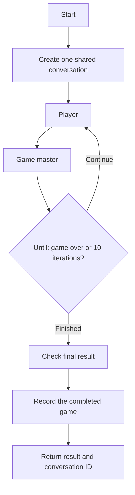

# Demo: Logic Apps Automation

> How can two Foundry agents share a conversation while a workflow controls execution and records the outcome?

Use [Azure Logic Apps Automation](https://auto.azure.com/) to run the [stateful workflow definition](../../automation/workflow.json). This is an Automation workflow, not a deprecated Foundry Workflow agent or a separately provisioned Consumption logic app.

## Setup

Automation has an independent `AUTOMATION_LOCATION` (default `westus`). The project name includes this region when it differs from `AZURE_LOCATION`, so changing the Automation region does not move Foundry, the tracker, or AI Gateway.

1. Run `azd up`. The post-deploy hook deploys the Foundry `player` and `gameMaster` agents, creates the Automation project and its `guessing-game` application if needed, and publishes the single stateful workflow from `automation\workflow.json`. Existing projects are preserved because the preview service can fail on repeated project PUTs.
1. The hook grants the Automation **application** identity **Foundry User** on `FOUNDRY_PROJECT_RESOURCE_ID` only. Agent calls use HTTP managed-identity authentication with audience `https://ai.azure.com`; they require no gateway key or Automation-side agent connection.
1. Open `auto.azure.com` and select the project named by `azd env get-value AUTOMATION_PROJECT_NAME`, the `guessing-game` application, and the **`guessing-game` workflow**.
1. The hook configures the following parameters automatically. Do not put credentials in the workflow JSON.

    | Parameter | Value |
    | --- | --- |
    | `foundryProjectEndpoint` | `PROJECT_ENDPOINT`, without a trailing slash. The workflow appends `/openai/v1/conversations` or `/openai/v1/responses`. |
    | `playerAgentVersion` | The deployed `player` version, saved as `PLAYER_AGENT_VERSION` in azd state. |
    | `gameMasterAgentVersion` | The deployed `gameMaster` version, saved as `GAME_MASTER_AGENT_VERSION` in azd state. |
    | `gameTrackerApiUrl` | `GAME_TRACKER_API_URL`, without a trailing slash. This is the Container App backend. |

1. Keep the **Request** trigger and **Response** actions. Protect the HTTP trigger with the authentication options available in your application, and treat its signed callback URL as a secret.
1. Deployment invokes the published workflow with `{}` and fails if it does not return a completed, recorded game. For interactive changes, use **Test**, inspect the draft run, then **Publish**. Keep `LOGIC_APPS_WORKFLOW_URL` synchronized if the published trigger URL changes.

The portal designer and **Test** prefer a saved `workflow-draft.json` over the published `workflow.json`, together with the application's draft parameters. An azd publication does not discard an existing portal draft. Compare the draft with the published definition before saving or publishing; preserve wanted edits before discarding or restoring a draft. **Reload the workflow tab after a server-side draft change** so a stale browser copy does not overwrite it.

## What to demonstrate

The workflow creates **one Foundry conversation per game**. Both agents use the same conversation ID, and Foundry automatically stores their inputs and outputs. The player speaks first; the game master chooses its number and explains the rules on its first turn. Both agent calls remain inside the ten-turn loop.



The workflow has **nine actions**: conversation creation, the Until container, two agent calls, one final result check, recording, success/error responses, and failure termination. The loop contains only **Player -> Game master**. There are no variables, `Remember_*` or `Read_*` cards, history replay, child workflows, transcript filtering, or separate private state.

The HTTP cards invoke the deployed Foundry agents by name and pinned version, not raw model prompts. The preview native `Agent` card cannot run inside Until and does not expose an input to reuse this shared conversation. Agent instructions contain only game behavior; their strict JSON response formats are configured on the agent definitions, not on each request.

While playing, the master's `number_picked` is `null`. The master reveals an integer only in its final won/lost reply. All hints must remain consistent with that number. This conversation-only design stores public messages, not an unspoken initial choice; it does not independently prove that a private secret was fixed at the start.

Until has **Count = 10** and a **five-minute timeout**. There is no separate counter. Its iteration index supplies the current turn to the agents and to response metadata, from which the final result reads the actual number of turns. The loop stops when the game ends or an agent response is incomplete. Normal count-limit completion allows a ten-turn loss; a correct tenth guess still wins.

Responses can include multiple assistant messages. The workflow parses the final assistant text message inline rather than concatenating all output text. The one final check rejects incomplete responses, a mismatched conversation or guess, inconsistent final status/hint/number, and a loss before turn ten. It does not re-read and audit the complete transcript before recording.

The tracker receives only `{conversation_id, number_picked, status}`, with the **actual shared Foundry conversation ID** and real number (1-100), including for a loss. HTTP 200 is returned only after recording succeeds. A win includes `{"status":"won","number":42}`; a loss preserves the original `{"status":"lost","number":"-1"}` message. Execution or recording failures return HTTP 502 and fail the run rather than becoming game losses. Agent calls and recording have no automatic retries.

## Inspect the conversation

Each game returns `conversation_id`, `game_run_id` and `trace_id` separately. Both agents propagate the same W3C trace ID. In **Foundry -> Agents -> Traces**, search the returned trace ID and open its **Conversation ID** to inspect both agents' dialogue. The Foundry conversation-items API also provides the stored history.

Automation **Monitoring** shows workflow actions and loop iterations. Agent HTTP inputs/outputs are intentionally secured in that view; use the authorized Foundry conversation and traces for the dialogue.

## Run from the command line

Python 3.10+ is sufficient; the caller has no package dependencies:

```powershell
$env:LOGIC_APPS_WORKFLOW_URL = azd env get-value LOGIC_APPS_WORKFLOW_URL
python .\automation\run_workflow.py
```

The runner invokes Logic Apps, validates the completed result and recording confirmation, and exits nonzero on errors. It does not call Foundry agent APIs or record the session a second time.

Example response (IDs and agent versions vary):

```json
{
  "conversation_id": "conv_example",
  "number_picked": 42,
  "status": "won",
  "turns": 6,
  "message": {
    "status": "won",
    "number": 42
  },
  "session": {
    "message": "Game session recorded: won (number: 42, conversation: conv_example)",
    "session_id": "recorded-session-id"
  },
  "game_run_id": "automation-run-id",
  "trace_id": "shared-trace-id",
  "agent_versions": {
    "player": "5",
    "game_master": "19"
  }
}
```

If a caller disconnects or times out, inspect run history before starting another run: the original workflow may still complete and persist a session. The demo tracker does not deduplicate repeated submissions. The REST backend is public and unauthenticated for demonstration; configure backend authentication/network restrictions before production use.

The old native-agent child workflows and connection in an existing deployment are not automatically deleted, but this workflow no longer uses them.

See the official [Automation workflow quickstart](https://learn.microsoft.com/azure/logic-apps/automation/quickstart-create-dynamic-automation-workflows) and [workflow/code-view reference](https://auto.azure.com/docs/features/workflows/).
